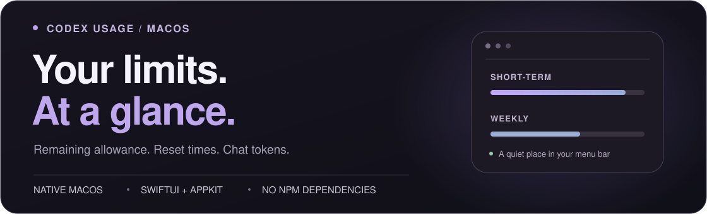

<p align="center">
  
</p>

<h1 align="center">Codex Usage</h1>

<p align="center">
  Remaining allowance, reset countdowns, and account tokens.<br>
  A small native panel that stays in your macOS menu bar.
</p>

<p align="center">
  <strong>macOS 13.5+</strong> &nbsp;·&nbsp; SwiftUI + AppKit &nbsp;·&nbsp; Apple Silicon + Intel
</p>

<p align="center">
  <a href="https://github.com/macacacacaca/codex-usage-panel/releases/latest"><strong>Download for macOS</strong></a> &nbsp; / &nbsp;
  <a href="#quick-start">Quick start</a> &nbsp; / &nbsp;
  <a href="#the-panel">The panel</a> &nbsp; / &nbsp;
  <a href="docs/guide.md">User guide</a> &nbsp; / &nbsp;
  <a href="SECURITY.md">Security</a>
</p>

---

## The panel

<p align="center">
  
</p>

<p align="center">
  <sub>v0.3.2 usage screenshot · Traditional Chinese interface · Taipei time</sub>
</p>

**Your allowance, at a glance.** Two rows of percentages show the remaining short-term and weekly allowance in a compact **32 pt** menu bar indicator. One click opens the **336 × 330 pt** panel. It follows your macOS light or dark appearance.

| In the menu bar | Inside the panel |
| :--- | :--- |
| Remaining short-term allowance | Reset countdowns and exact reset times |
| Remaining weekly allowance | Token total for the currently signed-in account |
| A compact indicator with no Dock icon | Local input/output details and an estimated USD equivalent |

The main token total uses the official account lifetime total when available, or verified local logs for the current account as a fallback. Input/output details and USD estimates cover that account's logs **on this Mac**, including archived sessions; they may cover less usage than the official total. **The USD value is an API pricing estimate, not a ChatGPT/Codex subscription bill or an actual charge.**

## Quick start

### 1. Download for your Mac

| Your Mac | Download v0.3.3 |
| :--- | :--- |
| Apple Silicon — M1, M2, M3, M4, or later | [Apple Silicon app · arm64](https://github.com/macacacacaca/codex-usage-panel/releases/download/v0.3.3/CodexUsage-v0.3.3-macos-arm64.zip) |
| Intel | [Intel app · x86_64](https://github.com/macacacacaca/codex-usage-panel/releases/download/v0.3.3/CodexUsage-v0.3.3-macos-x86_64.zip) |

Requires **macOS 13.5 or later** and an installed **Codex app or CLI signed in with ChatGPT**. Release apps include Node.js **24.21.0** and the local data service; you do not need Node.js, npm, or Apple Command Line Tools to run them. Codex itself is not bundled. Find checksums and release notes on the [Releases page](https://github.com/macacacacaca/codex-usage-panel/releases/latest).

### 2. Unzip, move, and open

1. Unzip the download and drag **CodexUsage.app** to **Applications**.
2. Open the app. Its two rows of percentages appear in the menu bar, with no Dock icon or terminal required.
3. This release is **ad hoc signed, without a Developer ID signature or Apple notarization**. If macOS blocks the first launch, use **System Settings → Privacy & Security → Open Anyway** after trying to open it, then confirm **Open** only if you trust this download. See [Apple's opening guidance](https://support.apple.com/102445).

### 3. Follow your signed-in account

The panel follows your current Codex sign-in automatically. **No chat ID setup is needed.** Account changes or sign-out clear the previous account's counters; local sessions with an unverified owner are excluded. Release packages contain **no credentials, session records, or personal runtime settings**.

It runs as a standalone macOS app, with a Traditional Chinese interface and Taipei time. Official account data can arrive later than local activity; the panel does not guarantee immediate cloud updates.

<details>
<summary><strong>Prefer to build from source?</strong></summary>

Along with macOS 13.5+ and Codex sign-in, source builds require:

| Requirement | Version or setup |
| :--- | :--- |
| Node.js | **22.18 or later** |
| Apple Command Line Tools | Swift; install with `xcode-select --install` |

There are **no third-party npm dependencies**. You can build directly without running `npm install`.

```sh
git clone https://github.com/macacacacaca/codex-usage-panel.git
cd codex-usage-panel
npm run build:native
open outputs/CodexUsage.app
```

The build creates an ad hoc signed app for your Mac's architecture. A regular source build uses your installed Node.js; downloadable releases bundle their own runtime. See [development and release packaging](./docs/development.md) for details.

</details>

## Everyday use

- **Open or close:** click the menu bar percentages. Escape or the × button closes the panel.
- **See token details:** click the token card. Use the back button to return.
- **Adjust pricing:** select API Standard or Fast in settings. This changes the estimate's pricing scenario.
- **Quit:** choose Quit in settings or right-click the menu bar indicator.

The native app refreshes official account limits and token summaries every **60 seconds**; the current account's local token aggregate updates every **10 seconds**. Automatic launch at login is not configured. Source users can also use the [launch script](./啟動用量面板.command), which builds on first use, and the [stop script](./停止用量面板.command).

If the menu bar is crowded, switch to Finder, then hold **⌘** and drag the indicator toward the clock. See the [full usage guide](./docs/guide.md#launch-and-quit) for service management and menu bar limitations.

## Privacy by design

The panel reuses sign-in managed by Codex CLI and reads usage through the official Codex App Server. It does not read or copy credential files or start model conversations.

- **Local service:** binds to `127.0.0.1`, validates request origins, and requires same-origin JSON for writes.
- **Account isolation:** verifies identity before and after reads; account email and IDs stay out of the frontend and logs.
- **Limited chat data:** aggregates only verified sessions belonging to the current account, including archived local sessions. Keeps only identity, model information, and token counters while reading; regular messages are skipped.
- **Minimal storage:** token values are not saved separately. Runtime files contain process metadata, with no credential or account snapshots. Release builds contain no personal settings or session records.

Use this as a local tool for your macOS user. Do not expose the service to the internet through a proxy, tunnel, or port forwarding. See [security and privacy guidance](./SECURITY.md) (Traditional Chinese) for protections and private vulnerability reporting.

## Go deeper

| Read | Find |
| :--- | :--- |
| [User guide](./docs/guide.md#launch-and-quit) | Launch, quit, settings, menu bar placement, and runtime files |
| [Data and refresh behavior](./docs/guide.md#data-features-and-web-development-version) | Native refresh intervals, the web development version, and recovery |
| [Tokens and USD estimates](./docs/guide.md#tokens-and-usd-equivalent) | Official account totals, local details, account checks, and pricing assumptions |
| [Sign-in and data sources](./docs/guide.md#sign-in-and-data-sources) | App Server protocol, identity checks, and local HTTP boundaries |
| [Development](./docs/development.md) | Commands, source map, testing, and secret scanning |
| [Known limitations](./docs/guide.md#known-limitations) | CLI compatibility, polling, and unsupported features |

---

<sub>Design inspiration: <a href="https://www.awwwards.com/sites/reflect">Reflect — Awwwards Honorable Mention, May 11, 2023</a>. Original banner artwork and layout adapted for GitHub Markdown.</sub>
