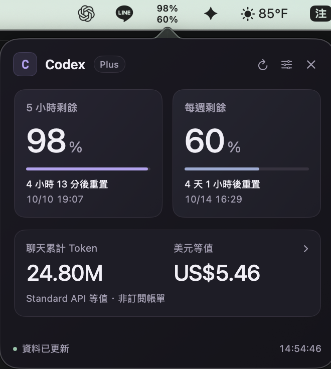

# Codex Usage: macOS Menu Bar

A native macOS menu bar app for monitoring Codex usage. A compact **32 pt wide indicator with two rows of percentages** shows your remaining short-term allowance on top and weekly allowance below. Click it to open a 336 × 330 pt panel with reset countdowns, cumulative chat tokens, and an estimated USD equivalent. Built with SwiftUI and AppKit, the app requires no WebView or browser. The interface uses Traditional Chinese and Taipei time, and follows the macOS light or dark appearance.

## Screenshot



This screenshot shows the app in actual use. Values and reset times update with account usage. The USD equivalent is an estimate based on API pricing, not a subscription bill.

## Build from Source

Requires macOS **13 or later**, Node.js **22.18 or later**, Apple Command Line Tools (Swift), and Codex CLI signed in with ChatGPT. There are no third-party npm dependencies, so `npm install` is unnecessary.

```sh
git clone https://github.com/macacacacaca/codex-usage-panel.git
cd codex-usage-panel
npm run build:native
open outputs/CodexUsage.app
```

Install Apple Command Line Tools with `xcode-select --install` if needed. Run `codex login` if Codex CLI is not signed in; you can also reuse the sign-in managed by your local Codex or ChatGPT app.

The build produces an Apple Silicon or Intel app for your machine's architecture at `outputs/CodexUsage.app`, with an ad hoc signature. After the first launch, open settings using the gear icon and paste the chat ID you want to track.

## Launch and Quit

1. After building, double-click `outputs/CodexUsage.app` or use the [launch script](./啟動用量面板.command), which builds the app automatically on first use. The panel opens on launch. Afterward, click the **two rows of percentages** in the macOS menu bar to open it. Opening the app again while it is running also expands the panel.
2. Click the menu bar indicator to expand or collapse the panel. The × button in the upper-right corner and Escape also close it; right-click the indicator to open the panel or quit. The app has no Dock icon and does not require an open terminal.
3. Choose Quit in the upper-right settings page, or double-click the [stop script](./停止用量面板.command). The app stops the data service it started. If it reused another instance's service, that service remains running.
4. To reopen the app, double-click it again. Automatic launch at login is not configured, and the app does not modify system login items.

If another app's menus or the screen notch hide the indicator, switch to Finder without quitting your current app, then **hold ⌘ and drag the two rows of percentages toward the clock**. Native `NSStatusItem.autosaveName` preserves the position. macOS provides no public API to force the indicator to the far right or guarantee that it stays visible.

Token Details opens a separate page with input, cached input, output, total tokens, and USD values starting at the top. Use the upper-left back button to return. Settings also uses a separate page. If token records are unavailable, the app explains why and provides a settings entry point.

The visual design in version 0.3.2 takes inspiration from [Reflect's Awwwards entry](https://www.awwwards.com/sites/reflect): adaptive dark and light backgrounds, thin lavender and muted blue progress bars, subtle borders, and separate font sizes for numbers and percentage signs. Click anywhere on the main token card to see details. API Standard/Fast pricing scenarios and Quit are available in the upper-right settings page. The panel remains 336 × 330 pt, with a 32 pt menu bar indicator.

The app manages its local data service automatically. HTTP/SSE is used for internal data transfer, so users do not need to open a URL. Native process records, the tracked chat ID, and startup logs that exclude sensitive data are stored in `~/Library/Application Support/CodexUsage/runtime/`. Native pricing preferences are stored in UserDefaults; token data is not saved separately. If an older service occupies port 4317, use the stop script to quit the old version before opening the app.

Local validation used Node.js **24.21.0** on Apple Silicon. The app prefers the CLI executable bundled with the local Codex or ChatGPT app.

The native app uses port 4317 and can reuse a service of the same version that exposes the native endpoints. Running one usage tool at a time is recommended. This is a standalone macOS menu bar app, separate from the Codex app.

## Data Features and Web Development Version

The native app refreshes account limits every 60 seconds, treating the persistent menu bar indicator as visible. Local token records are read every 10 seconds. The web version remains available for development using `npm start` or `啟動網頁測試版.command`. The configurable refresh intervals, browser preferences, and Alt+R shortcut below apply to the web version.

- Displays short-term, long-term, and other allowance categories supplied by the source. Percentages and progress bars show the **remaining** allowance.
- Refreshes every 30, 60, or 120 seconds while visible, depending on settings. After being hidden for more than one minute, it refreshes every five minutes. With multiple panels, the shortest interval among visible panels is used.
- Background refreshes keep cards visible. Failed reads retain the last snapshot for a verified identity. After 120 seconds without a successful read, the display is marked as stale.
- Recalculates countdowns every 30 seconds from the absolute reset time. At zero, the service reads again; the allowance is not shown as replenished until that read succeeds.
- Supports manual refresh, live SSE status, a 15-second deadline for a complete read, and retry backoff of 15, 30, 60, 120, and 300 seconds with jitter.
- Stores system/light/dark theme, time zone, and refresh preferences in the browser. Account and allowance data remain in process memory.
- Uses a native browser dialog for settings, closed with Escape. All controls support Tab navigation; **Alt+R** refreshes. Countdown updates are not announced through a screen reader live region.
- Shows available resets only when the source provides them. The panel cannot use resets or purchase allowance.
- Reads new local chat token records every 10 seconds without increasing account API polling. API Standard/Fast USD conversion can be selected.

## Tokens and USD Equivalent

The cumulative chat token card tracks one selected chat. Building the app does not read or bundle a local tracking ID. On first use, paste a chat ID into the upper-right settings page; subsequent launches reuse your runtime settings. Leave it blank to stop tracking. The ID can be obtained from a `codex://threads/<ID>` link. The web development version uses `.runtime/tracking.json` and `CODEX_THREAD_ID`; use `CODEX_USAGE_THREAD_ID=<UUID> npm start` to select a chat explicitly. Switching chats in Codex does not automatically change the tracked chat.

When reading Codex `sessions/` JSONL records, the service retains only session identity, model information, and `token_count` counters. It verifies the record ID and matches `creator_account_id` against the verified account's usage `accountId`; tokens are hidden if they do not match. Reads are incremental, and duplicate events are not counted twice. Truncated or missing files, model changes, and incomplete records trigger revalidation. Regular chat messages are skipped and are not sent to the frontend, logs, or other services. Token data is not saved separately.

The estimated USD equivalent uses [official API pricing](https://developers.openai.com/api/docs/pricing). **It is not a ChatGPT/Codex subscription bill or an actual charge.** API Standard is the default pricing scenario; Fast (2×) can be selected in settings. This is a user-selected pricing scenario, not an indication of the execution speed recorded in the session. Pricing was checked on **2026-10-08**, with support for `gpt-6.1-sol`, `gpt-6-astra`, and `gpt-6-luna`. For a single request with more than 272,000 input tokens, input, cached input, and cache-write rates are multiplied by 2, and output rates by 1.5, before applying the selected scenario.

Formula: `(uncached input × input rate + cached input × cached-input rate + cache writes × cache-write rate + output × output rate) ÷ 1,000,000`. Uncached input excludes cached input and cache writes. Reasoning tokens are already included in output and are not added again. If the model, token breakdown, events, or per-request length are incomplete, the app shows “—” instead of a partial price. Estimates exclude tools, storage, regional surcharges, and other charges. Update `src/tokens.ts` when prices change.

Historical account totals and date buckets in the details page come from `account/usage/read`. The source may not yet include the current day's usage. Dates are displayed as supplied and should not be treated as “today” in Taipei time. Account totals are not converted to USD because model information and input/output breakdowns are unavailable.

## Sign-In and Data Sources

Data comes from the official [Codex App Server](https://learn.chatgpt.com/docs/app-server). The app launches `codex app-server --listen stdio://` and completes the `initialize`/`initialized` handshake. The adapter allows only `initialize`, `account/read`, `account/rateLimits/read`, and `account/usage/read`; it does not start model conversations. A failed token history endpoint does not disable allowance tracking.

The panel reuses ChatGPT sign-in managed by Codex CLI without reading or copying credential files. If you are not signed in, run `codex login` in a terminal, complete the official flow, and refresh. API key and Bedrock sign-ins do not provide the subscription allowances required by this panel; the app displays an explanation.

The service checks the signed-in identity using `account/read` before and after each read and requires an `accountId` in allowance responses. The raw email is used only in memory to compute an identity digest, and `accountId` is used only for internal account isolation. Neither is sent to the frontend or logs. Old data is cleared when identity cannot be verified, on sign-in notifications, or when App Server disconnects. Temporary allowance read failures may retain a snapshot from the same verified sign-in session.

The service binds only to `127.0.0.1`. It validates Host, Origin, and cross-site requests, does not enable CORS, and requires same-origin JSON for POST requests. Pages accept only their own scripts and styles; APIs expose only normalized allowance and token information. `.runtime/` stores process and instance metadata and the selected chat ID, with no account snapshots, token snapshots, or credentials. Do not expose this service to the internet through a reverse proxy.

## Development and Validation

```sh
npm run probe  # Read-only diagnostics: plan, windows, and presence of identity fields
npm run probe -- --tokens  # Include normalized token endpoint diagnostics
npm run build  # Native Node.js TypeScript type stripping; generate browser JavaScript
npm run build:native  # Build SwiftUI/AppKit app, bundle the service, and sign ad hoc
npm test  # Normalization, time boundaries, isolation, recovery, cleanup, HTTP boundaries
npm run security:check  # Scan the Git index and full history with a checksum-verified scanner
npm run demo  # Clearly labeled demo mode; does not start Codex App Server
```

`native/` contains the menu bar app, native views, SSE client, and service process management. `src/native.ts` generates native data payloads and shares the USD formula with the web interface. `src/adapter.ts` handles JSONL RPC; `src/service.ts` manages identity, shared polling, snapshots, and recovery; `src/domain.ts` normalizes allowance data; `src/tokens.ts` normalizes tokens and calculates prices; `src/local-tokens.ts` verifies and incrementally reads chat records; and `src/client.ts` implements the web interface. `outputs/CodexUsage.app` is the runnable app; `web/` and `dist/` provide the retained web development version.

Validation on 2026-10-10: `npm test` completed with **25 passed and 0 failed**, covering normalization, account isolation, token calculations, process cleanup, HTTP boundaries, private file permissions, and native data endpoints.

`outputs/`, `.runtime/`, `dist/`, and environment files are excluded by `.gitignore`. The public screenshot is stored in `docs/screenshots/`. Users build the app locally and keep other local validation artifacts outside the repository.

See [SECURITY.md](./SECURITY.md) for security protections, data scope, and reporting guidance.

## Known Limitations

- The Codex CLI/App Server protocol continues to change. This version was checked against the TypeScript schema generated by CLI **0.162.0-alpha.2**. Repeat connection checks and validation after updating the CLI.
- The current `account/read` schema does not provide a separate account ID. The panel uses a digest of the sign-in email together with the usage response's `accountId`, checking identity before and after reads. Allowance data is hidden if either identity field is missing.
- A separate App Server is not guaranteed to receive usage notifications generated by other clients, so polling remains necessary. Sparse notifications trigger a complete reread.
- The native menu bar app runs separately from Codex and does not automatically follow the currently open chat. Change the tracked chat in settings.
- Desktop notifications, historical trends, and purchasing or consuming resets are not supported.
- Background browser timers may be throttled. The shared service continues polling, and becoming visible again or waking the computer triggers a refresh.
